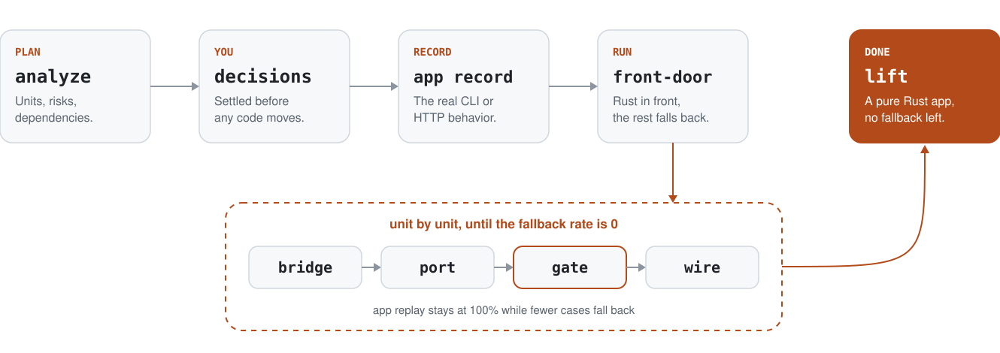

<p align="center">
  <a href="https://rustanything.ai/">
    
  </a>
</p>

<h1 align="center">Rust Anything</h1>

<p align="center">
<a href="https://crates.io/crates/rust-anything"></a>
<a href="https://www.npmjs.com/package/rust-anything"></a>
<a href="https://github.com/erkamyaman/rust-anything/stargazers"></a>
<a href="https://discord.gg/FXhUEA8eBR"></a>
<a href="https://github.com/erkamyaman/rust-anything#license"></a><br>
<a href="https://rustanything.ai/"></a>
<a href="https://crates.io/crates/rust-anything"></a>
<a href="https://www.npmjs.com/package/rust-anything"></a>
</p>

<div dir="rtl">

<p align="center">
أعد كتابة تطبيقك بلغة Rust، وأثبت أنه ما زال يعمل بالطريقة نفسها.
</p>

<p align="center">
<a href="https://trendshift.io/repositories/363468" target="_blank" rel="noopener noreferrer"></a>
<a href="https://trendshift.io/repositories/363468" target="_blank" rel="noopener noreferrer"></a>
</p>

<p align="center"><b>التوثيق:</b> <a href="https://rustanything.ai/ar">https://rustanything.ai/ar</a></p>

<p align="center"><a href="translations.md">🌐 لغات أخرى</a></p>

<p align="center">تنقل قاعدة شيفرة إلى Rust؟ أقدّم استشارات لعمليات الترحيل إلى Rust: <a href="mailto:hello@rustanything.ai">hello@rustanything.ai</a></p>

<p align="center"><sub>هذه الترجمة يحافظ عليها المجتمع، وقد تتأخر عن <a href="../README.md">README الإنجليزي</a>.</sub></p>

## الرعاة

<p align="center">صُنع في Türkiye 🇹🇷 بواسطة <a href="https://github.com/erkamyaman">erKam Yaman</a><br>
Rust Anything مجاني ومفتوح المصدر. إن كان يفيدك في عملك، فرعايتك تبقيه مستمرًا.</p>

<p align="center">
  <a href="https://coderabbit.link/er-kam">
    <picture>
      <source media="(prefers-color-scheme: dark)" srcset="assets/sponsors/company-dark.svg">
      
    </picture>
  </a>
</p>

<p align="center">
  <a href="https://www.atakdomain.com/">
    <picture>
      <source media="(prefers-color-scheme: dark)" srcset="assets/sponsors/domain-dark.svg">
      
    </picture>
  </a>
</p>

<p align="center">
  <a href="https://github.com/sponsors/erkamyaman">
    <picture>
      <source media="(prefers-color-scheme: dark)" srcset="assets/sponsors/sponsors-dark.svg">
      
    </picture>
  </a>
</p>

<p align="center">
  <a href="https://github.com/sponsors/erkamyaman"></a>
  <a href="https://buymeacoffee.com/erkamyaman"></a>
</p>

<p align="center">رعاية بصفتك شركة، أو أي أمر آخر؟ <a href="mailto:hello@rustanything.ai">hello@rustanything.ai</a></p>

<p align="center">تنقل قاعدة شيفرة إلى Rust؟ أقدّم استشارات لعمليات الترحيل إلى Rust: <a href="mailto:hello@rustanything.ai">hello@rustanything.ai</a></p>

## البدء السريع

الصق هذا في وكيل البرمجة لديك:

```text
Install Rust Anything with npm i -g rust-anything, then run rust-anything setup. Run rust-anything go -- <slow command of this app> and finish the port until rust-anything gate passes.
```

أو ثبّته بنفسك:

```sh
cargo install rust-anything   # أو: npm install -g rust-anything
rust-anything setup           # يضيفه إلى Claude Code وCodex وCursor وGemini CLI وOpenCode
rust-anything doctor          # يفحص بيئات التشغيل التي يحتاجها الأصل، مع طريقة الإصلاح لكل منها
```

> [!WARNING]
> التسجيل يشغّل الشيفرة الحقيقية للأصل. اعمل على نسخة، ووجّه أي خادم إلى قاعدة بيانات اختبارية.
> يشغّله `record --sandbox` و`app record --sandbox` دون شبكة، مع مستودع للقراءة فقط وحدود للمعالج والذاكرة (bubblewrap على Linux، وsandbox-exec على macOS؛ ويتحقق `doctor` من وجوده).

> **للوكلاء:** اقرأ [rustanything.ai/llms.txt](https://rustanything.ai/llms.txt) لخطوات التثبيت وكل الأوامر وسير عمل النقل.

## كيف يعمل

<p align="center">
  <picture>
    <source media="(prefers-color-scheme: dark)" srcset="assets/how-it-works/ar-dark.svg">
    
  </picture>
</p>

**ما الذي يُعدّ منجزًا.** السلوك، لا اختباراتك. يشغّل `record` الأصل على مدخلات مولّدة ومعطاة، ويحفظ ما يعيده كل استدعاء وما يرميه وما يطبعه. يكتمل النقل عندما ينجح `gate`: تتطابق كل حالة مسجّلة، وتنجح جميعها: fmt وclippy و`cargo test` وفحص `unsafe` وفحص البدائل الفارغة (stub) وفحص الإجابات المسجّلة الملصوقة في النقل. وتُشغَّل اختباراتك أيضًا.

**اختباراتك تصبح حالات.** يشغّل `record --from-tests -- npx jest` (أو `pytest`) مجموعة اختبارات الأصل نفسه، ويسجّل كل استدعاء تجريه للوحدة. ويثبّت `--pin-clock` الساعة والأرقام العشوائية في الجانبين، حتى تتطابق الشيفرة التي تعتمد على التاريخ.

<p align="center">
  <picture>
    <source media="(prefers-color-scheme: dark)" srcset="assets/how-it-works-app-dark.svg">
    
  </picture>
</p>

**تطبيقات كاملة: أدوات CLI وخوادم.** يسجّل `app record` أداة CLI (رمز الخروج وstdout وstderr والملفات المكتوبة) أو، مع `--http`، إجابات الخادم عن كل طلب. ويُنشئ `app front-door` المجلد `rust/app`، وهو ملف تنفيذي بلغة Rust يتولى نقطة الدخول ويسلّم كل ما لم يُنقل بعد إلى الأصل. وينقل `app wire` الوحدات واحدة تلو الأخرى، ويجب أن يبقى `app replay` عند 100% بينما تنخفض نسبة الرجوع إلى الأصل (fallback) إلى الصفر، ويترك `app lift` تطبيقًا مكتوبًا بـ Rust بالكامل.

**الآثار الجانبية تُحتسب.** النقل الذي ينسى إرسال الـ webhook أو البريد الإلكتروني يجب أن يفشل. يوجّه `app record --effects http,smtp` (أو `--effect-env WEBHOOK_URL=http-url`) التطبيق إلى بدائل محلية تسجّل كل استدعاء ورسالة صادرة، ويسجّل `--db-dump "sqlite3 app.db .dump"` قاعدة البيانات بعد كل طلب؛ ثم تتحقق إعادة التشغيل (replay) من أن النقل يفعل الشيء نفسه.

**الأصل لا يتوقف عن التغيّر؟** يعيد `app drift` تشغيل الأصل مقابل تسجيله ويعرض ما صار يجيب بشكل مختلف، و[GitHub Action](install.md#in-ci) يشغّل `gate` مع كل push.

**القرار لك.** عندما تصحّح سلوك النقل، يحتفظ به `rules --add "<rule>"`، ويتضمّنه كل موجّه (prompt) لاحق للوكيل. كل ما يكتبه rust-anything موجود في `<repo>/rust/`.

**تقرير أو ترحيل، الخيار لك.** يكتفي `analyze` و`profile` بالتقرير: خطة مرتّبة لما يجب نقله، وما هو الأكثر استهلاكًا للوقت تحت حمل عمل حقيقي. إنهما أمران عاديان، فلا يكلّف التقرير أي رموز (tokens). أما `go` فيرحّل وحدة واحدة: يبني جسرًا لأكثر دالة استهلاكًا للوقت، ويسجّلها، ويسلّم النقل إلى وكيلك، ثم يُجمّعه ويقارنه ويمرّره على `gate`، ولا يفعّله إلا عندما يتطابق كل شيء (TS/JS وPython وPowerShell؛ و`disable` يوقفه من جديد).

**كم يستغرق التشغيل.** تشغيل واحد لـ `go` ينقل وحدة واحدة، بحدّ أقصى `--rounds` من أدوار الوكيل (3 افتراضيًا): دور للنقل، ثم دور لكل diff أو gate يفشل. التطبيق كله تشغيل واحد لكل وحدة، فيمكنك التوقف بعد أيٍّ منها.

**نموذج رخيص للخطة، ونموذج قوي للنقل.** الخطة لا تحتاج إلى نموذج. للنقل، مرّر أي أمر وكيل: `rust-anything go --agent "claude --model <model>" -- <workload>`.

**الوكلاء.** يضيفه `rust-anything setup` إلى Claude Code وCodex وCursor وGemini CLI وOpenCode. ويمكن لأي عميل MCP آخر تشغيل `rust-anything mcp`، وتُثبَّت المهارة أيضًا وحدها عبر `npx skills add erkamyaman/rust-anything` (انظر [التثبيت](install.md)).

## اللغات

| اللغة | الحالة | فُحص على |
| --- | --- | --- |
| TypeScript/JavaScript | متحقَّق منه | ESLint, Prettier, json-server, Fuse.js, vercel/ms |
| Python | متحقَّق منه | `colorsys` من CPython (2,400/2,400 حالة) |
| Go | متحقَّق منه | `path` من Go (2,642/2,642) |
| Ruby | متحقَّق منه | `shellwords` من Ruby 3.3 (1,617/1,617) |
| Java | متحقَّق منه | JDK 21 خلف واجهة (facade) (4,492/4,492) |
| C | متحقَّق منه | libavutil من ffmpeg، وglibc |
| C# | متحقَّق منه | Google.Protobuf (2,941/2,941) |
| PHP | متحقَّق منه | PEAR `XML_Util` (1,838/1,838) |
| Kotlin | مختبَر | حالات الاختبار الثابتة (fixtures) في هذا المستودع، ومنها Android |
| PowerShell | مختبَر | حالات الاختبار الثابتة (fixtures) في هذا المستودع |

**متحقَّق منه** يعني أنه نُقل من البداية إلى النهاية على شيفرة حقيقية كتبها شخص آخر؛ و**مختبَر** يعني أنه مغطّى باختبارات هذا المستودع على fixtures. كل تشغيل، مع التواريخ وطريقة التحقق: [STATUS.md](STATUS.md).

## الأوامر

| الأمر | ما يفعله |
| --- | --- |
| `rust-anything go -- <workload>` | يحلّل الأداء، ويبني جسرًا لأكثر دالة استهلاكًا للوقت، ويسجّلها، ويسلّم النقل إلى وكيلك، ويمرّره على gate، ثم يفعّله |
| `rust-anything analyze <repo>` | خطة ترحيل مرتّبة: الوحدات، والجاهزية، والمخاطر، والاعتماديات |
| `rust-anything profile <repo> -- <workload>` | ما الأكثر استهلاكًا للوقت تحت حمل عمل حقيقي، وما الذي يجب نقله أو تجميعه |
| `rust-anything bridge <repo> <unit>` | حزمة crate بلغة Rust مع روابط (bindings) لوحدة واحدة، والبدائل الفارغة في `src/port.rs` |
| `rust-anything record <crate>` | يسجّل ما يعيده الأصل وما يرميه وما يطبعه (`--inputs`، `--from-tests`، `--pin-clock`) |
| `rust-anything diff <crate>` | يعيد تشغيل كل حالة مسجّلة مقابل وحدة Rust (module) |
| `rust-anything bench <crate>` | يقيس زمن الأصل وRust على الحالات المسجّلة، بما في ذلك الجسر |
| `rust-anything fuzz <crate>` | مدخلات جديدة عبر الجانبين: ما لم يغطّه التسجيل |
| `rust-anything gate <crate>` | تعريف الإنجاز |
| `rust-anything enable` / `disable <crate>` | يحوّل الاستدعاءات إلى Rust، أو يعيدها |
| `rust-anything report <crate>` | `REPORT.md` وبطاقة لطلب سحب (pull request) |
| `rust-anything app record` / `front-door` / `wire` / `replay` / `lift` / `drift` | ينقل أداة CLI أو خادمًا بالكامل |
| `rust-anything rules <repo> --add "<rule>"` | سلوك صحّحته، تحتفظ به كل عملية نقل لاحقة |
| `rust-anything map <repo>` | كل وحدة، وحزمتها crate، وحالاتها، وآخر diff |
| `rust-anything log <repo>` | كل تفعيل أو إيقاف، وكل نتيجة لـ wire وlift وgate، من `rust/audit.jsonl` |
| `rust-anything setup` / `doctor` / `mcp` | التثبيت للوكلاء، وفحص بيئات التشغيل، وخادم MCP |

## الرخصة

[MIT](../LICENSE-MIT) / [Apache-2.0](../LICENSE-APACHE) © [Erkam Yaman](https://github.com/erkamyaman). النقول والشيفرة المولّدة في
مستودعك ملكك.

</div>
